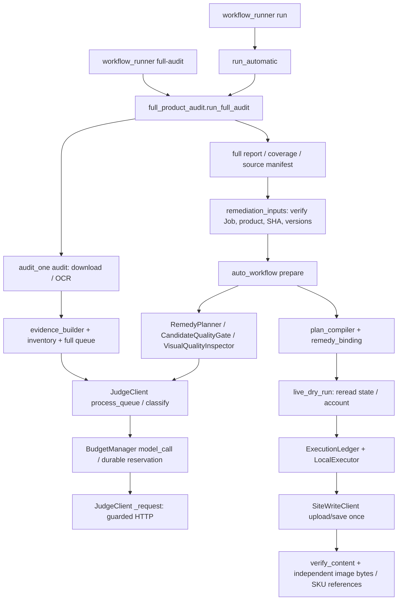

证据日期：2026-11-14；源码基线：20ecfe83e307bbe15e7e298954a7c57d90dcdca6；对照 a14669ba76aae5dbf72b00afe83b8028dc3cba97。
本轮范围：单Agent，本地开发/Fake/Mock；无真实模型或站点操作。最终本地验收见 automation-final-acceptance.md；Fake与真实证据严格分开。

# 生产调用链与契约

本轮只有Fake访问图中HTTP/Writer边界；full-audit仍为只读CLI。显式注入旧auditor的Python兼容路径保留既有候选流程，不能用它的测试证明完整审核验收。

full产物：Job/Shop/PID、canonical source state、full_inventory图片SHA及全部位置/SKU行哈希、原始结果full_ai_metrics、模型结果full_ai_judgements、coverage_matrix、协议prompt/schema指纹、full_audit_evidence_manifest。计划直接验证这些文件；原始模型evidence ID保留，不伪装成新响应。

语义按SHA推理，整改按业务位置映射。SKU_ROW为审核行标签，不能当数据库SKU ID；实际ID从绑定商品行读取，缺失不猜测。UNKNOWN按位置及全局检查显式WEB_DEFER。独立质量检查仍是额外门禁，不能用pHash授权。

CLI其他分支：apply/executor-request需当前计划、授权、预演；recover-readback仅只读观察；verify-saved独立内容复检；retry-translation专用翻译；rollback-preview/rollback-apply/rollback-readback独立恢复；review-submit人工异常入口；resume/status/report读取Job状态。本轮未运行这些真实操作分支。

写入链：policy.authorize → account_lock → live_dry_run → ledger.claim/begin_side_effect → LocalExecutor.execute_auto → 持久上传回执/expected_after → SiteWriteClient → recover/verify_content。APPLY_UNKNOWN阻断重发；跨Job同PID由ExecutionLedger占用保护。写后验证同时覆盖字节SHA、顺序、SKU映射及受保护字段，不仅URL。

兼容分支：run 的 read_only/apply 仍走既有 run()/workflow_v2_pipeline 候选路径；audit/dry_run/auto_apply 默认走本轮完整链路。兼容分支不获得真实调用权限，公共HTTP预算守卫仍生效；CONTROLLED_CANARY仅允许新Job的audit/dry_run，旧模式不能借新预算获权。本轮未运行其真实操作。
