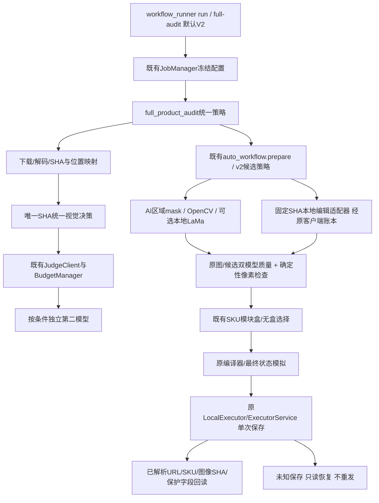

# V2.0 当前调用链

## 当前：Q01–Q24已授权真实只读回归

Q01–Q24的24张本地原图真实只读回归已结束：47次请求（仅DeepSeek/MiMo，无重试），最终动作REVIEW 23、KEEP 1；取得有效输出44条、未取得有效输出3条（含请求失败和格式错误）。本批网关已知Token 350370，未知usage 1次，费用null，仅记录。线上访问、上传、保存、删除和本地整改均0。完整目标仍未完成。

最新结果入口v2-qbatch-acceptance.md。805项离线测试源绑定未变；17份报告的以下旧记录均按原日期和源码检查点保留。OpenCV/完整LaMa已配置，普通本地去字不需要外部编辑配置。

## 前轮本地记录（历史原文保留）

最新完整离线回归：795 项通过，失败/错误/跳过均为0；run_id=1b76237b9bee4738a13a44366b72b38b。测试期间源码一致，无网络尝试；本轮真实模型调用及线上写入0。详见 v2-evaluation-full-tests.log、v2-evaluation-tests-status.json 和 v2-evaluation-test-source-manifest.json。783 项记录仅作为上一版源码历史检查点保留。

V2不调用OCR、模板/高通/残留语义分类链；传统算法只处理像素。程序在同一计划内完成删除与真实SKU换引用，编译器确认必要重绑已在计划中；原本仅SKU引用的修复图追加到已有SKU图片池位置后上传。没有新站点客户端或写入器。
