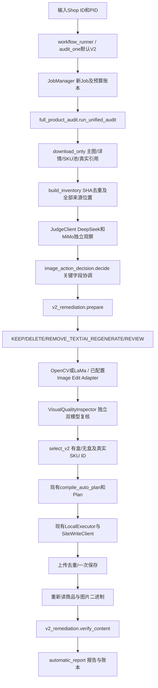

# V2完整生产调用链

read_only/full-audit停在只读视觉审核及报告，不调用整改上传。audit可生成本地候选与计划但不写站；dry_run只核对；auto_apply及新的run apply均受冻结策略及范围授权约束。单独apply还要求绑定Job/Plan的确认文件。恢复使用recover-readback/verify-saved，只读确认，不重发保存。

legacy仅为显式历史兼容，不是新正式V2路径；run内部遇到V2也转统一完整审核，禁止落入旧机器候选管线。分类唯一来源AI视觉，OpenCV/LaMa只处理像素与mask。所有模型与编辑适配器请求复用原JudgeClient/BudgetManager。
